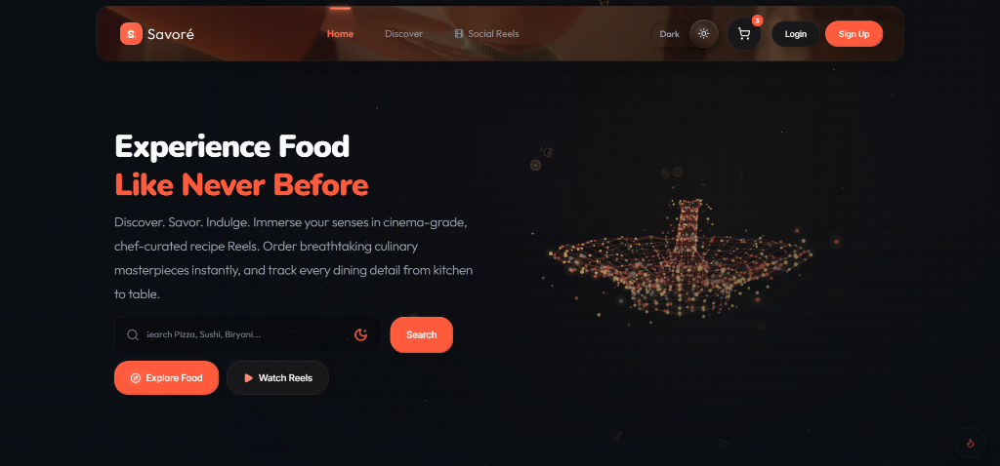
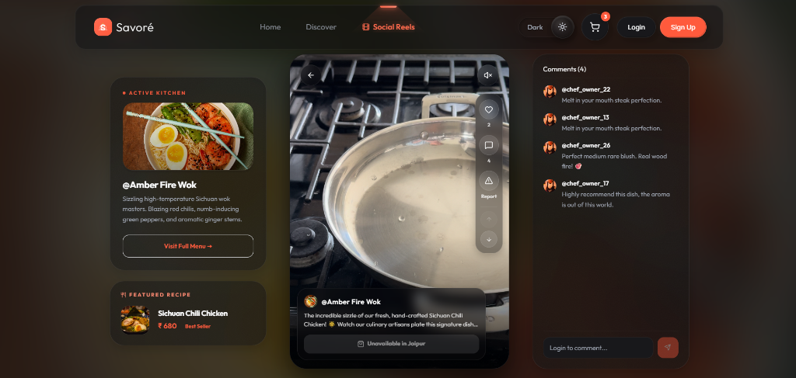
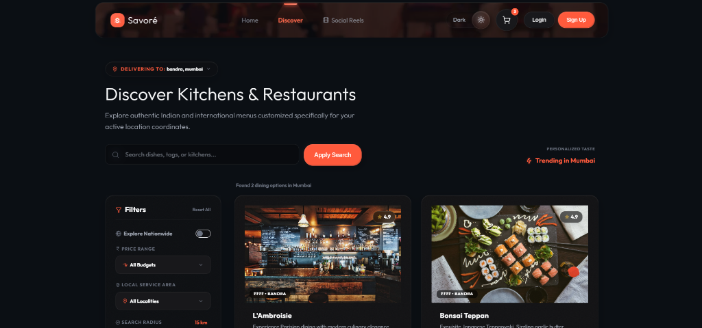
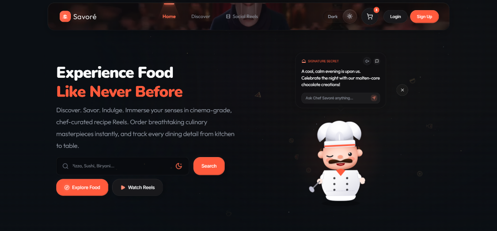
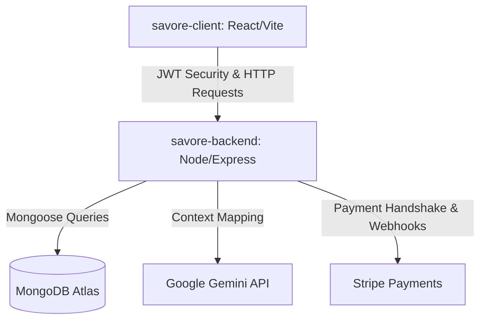

# 🚀 SAVORÉ — Premium Cinematic Food-Tech SaaS Platform

[](https://react.dev)
[](https://nodejs.org)
[](https://www.mongodb.com)
[](https://stripe.com)
[](https://framer.com/motion)

Savoré is a **production-grade, recruiter-friendly, and highly scalable MERN stack food-tech SaaS platform** that bridges the gap between premium culinary content and modern on-demand delivery. Designed with a **cinematic glassmorphism UI/UX design language**, Savoré offers an immersive, content-first experience featuring a dynamic, TikTok-style short video Reels engine, a conversational generative AI chef assistant, location-aware smart filtering, and deep merchant dashboards.

---

## 🎬 Live Showcases & Premium Visuals

Explore the visual design and cinematic interactions of Savoré:

| Cinematic Homepage | Immersive Reels Engine |
|---|---|
|  |  |

| Smart Restaurant Discovery | Chef Savoré AI Assistant |
|---|---|
|  |  |

---

## ✨ Outstanding Premium Features

### 🎥 1. Cinematic Video Reels Ecosystem
- **Seamless Buffering & Preloading**: A highly optimized TikTok-style vertical reels feed that dynamically preloads and pre-buffers MP4 assets as the user scrolls, providing a zero-latency transition.
- **Micro-Animations**: Framer-Motion-backed gesture systems for liking, commenting, and dynamically double-tapping to trigger custom floating hearts.
- **Context Synchronization**: Active reels dynamically synchronise food item states with the cart context.

### 🤖 2. Chef Savoré AI Assistant
- **Google Gemini Generative AI**: Powered by Google’s Gemini model, Chef Savoré is a persistent, location-aware chatbot that acts as a personal culinary guide.
- **Mood-Engine & Adaptive Expressions**: The AI chatbot dynamically responds to user queries, altering its expressions (curious, happy, passionate, professional) and sound-cues using a responsive audio/mood state engine.
- **Intelligent Recommendations**: Recommends actual restaurant menu items based on current weather, time of day, user profiles, and active location coordinates.

### 🗺️ 3. Smart Location-Aware Discovery
- **Contextual Search & Filters**: Restructures restaurant feeds in real time using client-side geolocation APIs.
- **Dynamic Weather Integration**: Uses current weather states (e.g., raining, sunny, hot) to suggest relevant items (e.g., warm ramen on rainy days, chilled smoothies on hot summer afternoons).

### 💳 4. Flexible Payment Architecture & Stripe Webhooks
- **Multi-Mode Checkout Engine**: Native support for Cash on Delivery (COD), interactive Card Payment, and an internal Merchant Kitchen Simulation mode with real-time GPS transit tracking.
- **Stripe SDK & Webhook Verification**: Production-ready PCI-compliant tokenized payment pipelines via Stripe Element gateways, complemented by cryptographic server-side webhook listeners (`payment_intent.succeeded`) that ensure atomic order state transitions and stock safeguards without client-side trust.

### 🔒 5. Hardened Security & RBAC
- **Token Rotation Protocol**: Protects against Session Hijacking by executing dual JWT access and refresh token mechanisms with secure cookie signatures and local rotation interceptors.
- **Role-Based Access Controls (RBAC)**: Strict API routing middleware and client page protection segregating **Customers**, **Restaurant Owners (Merchants)**, and **Global Administrators**.

---

## 🛠️ Technology Stack & System Requirements

### Frontend (Client)
- **React 19 (SPA)**: Component-driven hierarchy using modern Context APIs for state synchronization.
- **Tailwind CSS & CSS Custom Properties**: The core aesthetic uses dynamic custom property transitions for smooth Light/Dark mode changes and premium glassmorphism gradients.
- **Framer Motion**: State-driven layout animations, page-wipe transitions, and interactive physics overlays.
- **Vite 8 & Rolldown**: Ultra-fast hot module replacement (HMR) and optimized bundler tree-shaking.

### Backend (Server)
- **Node.js & Express**: Modular routing structure using custom async handlers and global JSON error formatting.
- **MongoDB & Mongoose ODM**: Fully relational schema modeling with strict Zod validations.
- **Helmet.js & Express Rate Limit**: Mitigates DDoS attacks and hardens security headers.
- **Multer**: Dynamic multipart disk-storage pipelines for secure media uploads.

---

## 🏗️ Monorepo Architecture Overview

Savoré leverages a highly modular and extensible workspace design designed to scale cleanly for future microservices, mobile apps, or database refactoring.



---

## 📂 Production Folder Structure

```filename
savore/
├── client/                 # React Frontend Application (Vite-driven)
│   ├── public/             # Static public assets
│   ├── src/
│   │   ├── assets/         # App-specific images, logos, vectors
│   │   ├── components/     # Reusable UI parts (Navbar, ChefSystem, SafeImage)
│   │   ├── context/        # React global state trees (Auth, Cart, Reels, Location)
│   │   ├── hooks/          # Custom react hooks (usePolling)
│   │   ├── pages/          # Full-page screens (Home, Discover, Reels, UserProfile)
│   │   ├── utils/          # API configs, price formatters, media handlers
│   │   ├── App.jsx         # App routing and theme orchestration
│   │   └── index.css       # Core Tailwind CSS system & design tokens
│   ├── package.json
│   └── vite.config.js
│
├── server/                 # Node.js/Express Backend Services
│   ├── config/             # DB & Stripe Gateway initialization
│   ├── controllers/        # Core business & service controllers (AI, Reels, Orders)
│   ├── middleware/         # RBAC guard rails, token authenticators, file uploaders
│   ├── models/             # Mongoose DB strict schemas
│   ├── routes/             # Declared API routes mapping endpoints
│   ├── uploads/            # Local media disk store for short video feeds
│   ├── package.json
│   └── server.js           # Server application startup entrypoint
│
├── docs/                   # Engineering audits, database specs, API docs
├── assets/                 # Shared design systems & screenshots
│   └── screenshots/        # Living documentation image store
├── .env.example            # Global root-level environment reference
├── .gitignore              # Global git tracking specifications
├── package.json            # Root workspace script orchestrator
└── README.md               # Recruiter showcase and documentation
```

---

## ⚡ Setup & Installation Guidelines

Follow these sequential steps to clone, configure, and boot the entire Savoré workspace locally:

### 1. Prerequisite Requirements
Ensure you have the following installed on your machine:
- **Node.js** (v18.x or v20.x recommended)
- **npm** (v9.x or higher)
- **MongoDB** running locally (`mongodb://localhost:27017`) or a **MongoDB Atlas Cluster** URI.

### 2. Clone the Repository
```bash
git clone https://github.com/your-username/savore.git
cd savore
```

### 3. Install All Dependencies (Single Command)
Savoré utilizes **npm workspaces**. You can install dependencies for both the `/client` and `/server` in a single run from the root directory:
```bash
npm install
```

### 4. Setup Environment Configurations
Create a `.env` file in the **server directory** (and optionally inside the root or client directories). Use the provided `.env.example` as a foundation:

```bash
# In the /server directory, create a .env file:
PORT=5000
MONGO_URI=your_mongodb_connection_uri
JWT_SECRET=your_super_secure_jwt_access_secret
JWT_REFRESH_SECRET=your_super_secure_jwt_refresh_secret
STRIPE_SECRET_KEY=your_stripe_test_secret_key
STRIPE_WEBHOOK_SECRET=your_stripe_webhook_secret_signing_key
GEMINI_API_KEY=your_google_gemini_api_key
```

*Note: Savoré is engineered with failure-recovery systems. If you start the client without a `VITE_API_URL` setting, it will automatically fall back to `http://localhost:5000/api` in your local dev session.*

### 5. Seed Mock Data
The database must be seeded with mock restaurants, dishes, food items, and cinematic reels before launch. Run the following command from the root folder:
```bash
# Seed Mongoose database collections
npm run seed --workspace=savore-backend
```

---

## 🚀 Running the Platform

### Running in Development Mode
You can spin up **both** the React Vite dev server and the Express backend server concurrently with a single command executed in the root workspace folder:
```bash
npm run dev
```
- **React Frontend**: accessible at [http://localhost:5173](http://localhost:5173)
- **Express Backend API**: running on [http://localhost:5000](http://localhost:5000)

### Running in Production
To build the client bundle and verify deployment readiness:
```bash
# 1. Compiles frontend client assets into /client/dist
npm run build

# 2. Start the Express API server (which can serve built assets)
npm start
```

---

## 🌐 Production Deployment Guide

Savoré is optimized to run smoothly on serverless and PaaS providers:

### Frontend (Client)
- **Vercel / Netlify**: Connect the repository, set the root directory to `client`, specify `npm run build` as the build command, and `dist` as the publish directory.
- Configure `VITE_API_URL` to point to your live backend domain (e.g. `https://api.savore.com/api`).

### Backend (Server)
- **Render / Railway**: Setup a Web Service, specify the root directory to `server`, select Node.js as the runtime, and set the start command to `node server.js`.
- Add all required environmental variables (Stripe key, JWT secret, Gemini key, Mongo URI) inside the provider dashboard.

---

## 🔮 Future Roadmap & Extensibility Features

Savoré is engineered to adapt and expand continuously:
- [ ] **Dockerization**: Containerize both service nodes for multi-region Kubernetes deployments.
- [ ] **Multi-Merchant Order Pipeline**: Enhance backend order schemas to support multi-restaurant cart item checkout flows and automatic vendor payout splits.
- [ ] **Recommender Neural Engine**: Supplement Chef Savoré with custom PyTorch recommendations tracking historical orders and user browsing sessions.
- [ ] **Redis Caching**: Integrate a Redis layer in `server/middleware` to store trending restaurant index feeds.
