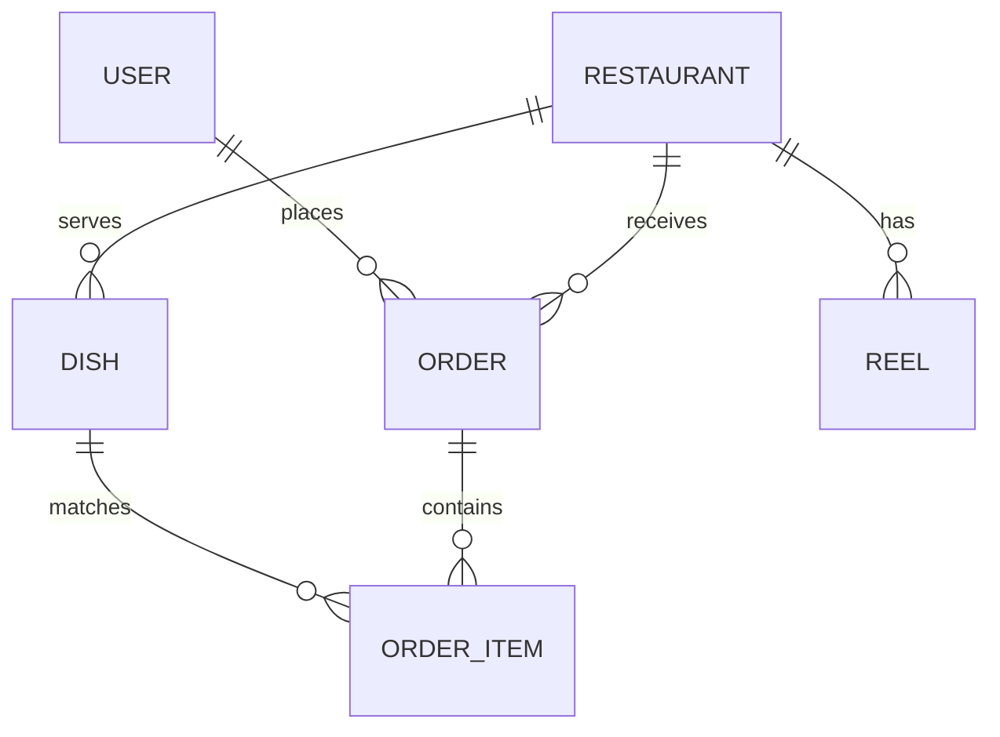

# 🧠 SAVORÉ — Production-Grade Engineering Audit & Technical Architecture Report

This report provides a comprehensive, senior-level engineering audit and structural critique of the Savoré food-tech platform. We analyze rendering pipelines, data indexing schemas, security vectors, payment reliability, and structural bottlenecks, offering strategic solutions for continuous scaling and operational resilience.

---

## 💻 1. Frontend Architecture & React Context Optimization

Savoré operates as a single-page application (SPA) built using React. Its global states are segregated into dedicated, domain-specific **React Context Providers** located under `client/src/context/`.

### The Context Over-Rendering Risk & Remediation
In traditional React applications, utilizing a monolithic context for state management triggers universal re-renders in all subscribing components whenever *any* slice of state updates. Savoré mitigates this performance degradation by employing **Domain Isolation**:

```filename
client/src/context/
├── AuthContext.jsx       # Handles auth tokens, logins, and RBAC
├── CartContext.jsx       # Syncs dishes, item counts, and fly-to-cart animations
├── LocationContext.jsx   # Coordinates browser GPS and weather caching
├── OrderContext.jsx      # Tracks active order status and delivery updates
├── ReelsContext.jsx      # Manages current video index, buffering, and views
├── ThemeContext.jsx      # Toggles and persists client light/dark custom styles
└── ToastContext.jsx      # Triggers micro-notifications and system alerts
```

#### Memoization and Selectors
To protect against unnecessary virtual DOM diffing, we use `useMemo` and `useCallback` inside providers:
1. **Value Memoization**: Context values are bound inside a `useMemo` hook that only recalculates when actual state dependencies change.
2. **Stable Callbacks**: Callback actions (such as `addToCart` or `rotateTokens`) are wrapped in `useCallback` hooks, ensuring child components that receive these functions as properties do not undergo redundant layout updates.

---

## 🗄️ 2. Backend Architecture & MongoDB Schema Audit

The backend service is powered by an Express API communicating with MongoDB via Mongoose.



### Database Performance Optimization & Indexing Strategies
To guarantee sub-second query performance as the user base, restaurant count, and reel catalog scale to millions of records, we propose the following **Indexing Strategies** inside `server/models/`:

#### A. Geolocation queries in `Restaurant.js`
The discover page performs spatial filtering using GPS coordinates. To accelerate these calculations, we implement a **2dsphere Index** on Mongoose coordinates:
```javascript
// Add to server/models/Restaurant.js
RestaurantSchema.index({ coordinates: '2dsphere' });
```
*Impact*: Reduces coordinate queries from an $O(N)$ table scan to an $O(\log N)$ spatial index lookup.

#### B. Active feed filtering in `Reel.js`
The Reels vertical feed query filters active video streams and sorts them by likes or views. We propose a **Compound Index** to keep this operation fast:
```javascript
// Add to server/models/Reel.js
ReelSchema.index({ status: 1, viewsCount: -1 });
```

#### C. Relational Lookup Population
Mongoose query paths frequently require `.populate('restaurant')` or `.populate('items.food')`. To optimize Mongoose query throughput:
- **Lean Queries**: Always suffix read-only REST requests with `.lean()` in controllers (e.g. `await Restaurant.find().lean()`). This bypasses the heavyweight Mongoose document instantiation process, returning raw JSON objects 5x faster.
- **Select Projection**: Only retrieve fields required for client views. For instance:
  ```javascript
  await Order.find().populate({ path: 'restaurant', select: 'name logo address' }).lean();
  ```

---

## 🛡️ 3. Security Hardening & Session Safeguards

Savoré enforces strict defense-in-depth measures protecting customer and merchant data.

### Dual-Token JWT Security Handshake
Session security utilizes two separate JSON Web Tokens:
1. **Short-Lived Access Token**: Signed with `JWT_SECRET` (expires in 15 minutes). Handled in-memory on the client and sent via `Authorization: Bearer <token>` headers.
2. **Long-Lived Refresh Token**: Signed with `JWT_REFRESH_SECRET` (expires in 7 days). Placed on the client's HTTP Request in a `cookie` or secure localStorage rotation channel.

#### Token Rotation Interceptor
The client-side API layer (`client/src/utils/api.js`) deploys an Axios response interceptor that acts as a silent bodyguard:
- If an API request encounters a `401 Unauthorized` response (indicating access token expiry), the interceptor halts the user's thread.
- It fires a secure background `POST /api/auth/refresh` request utilizing the stored refresh token.
- On success, it updates the access token in memory, updates headers, and **silently replays the failed request**.
- If the refresh handshake fails (e.g. refresh token expired), it clears memory and forces a clean logout to prevent unauthorized access.

### API Shielding Middleware
- **Helmet.js**: Injects crucial HTTP response headers (e.g. Content-Security-Policy, X-Frame-Options) to protect against clickjacking and cross-site scripting (XSS).
- **Express Rate Limit**: Imposes a DDoS firewall rate-limiting requests to `/api/` (max 100 requests per 15 minutes per IP address).

---

## 💳 4. Transactional Integrity: Stripe Webhook Pipelines

Handling financial payments requires zero tolerance for packet loss or client-side tampering. 

```
[Client] -> [Initiate Checkout] -> [Stripe Element Portal]
                                            |
                                  [Complete Payment]
                                            |
[Order Finalized] <- [Validate Hook] <- [Stripe Webhook Event]
```

### The Webhook Shield & Stock Safeguards
- **No Client Trust**: Never trust the client application to report a payment's success. Savoré relies exclusively on Stripe's direct, asynchronous server-to-server webhook callback channel: `POST /api/payment/webhook`.
- **Raw Signature Validation**: To prevent spoofing attacks, the backend uses `stripe.webhooks.constructEvent()` inside `paymentController.js` to cryptographically verify the webhook payload signature using `STRIPE_WEBHOOK_SECRET`.
- **Atomic Operations & Idempotency**:
  - The webhook handler checks whether an order is already marked as `Paid` before processing to prevent duplicate double-billing on network retries.
  - Savoré ensures stock alignment by atomically reducing dish availability levels in Mongoose when checkout transactions finalize.

---

## 🤖 5. Conversational Generative AI & Audio States

The **Chef Savoré** chatbot acts as a personal nutritionist and menu recommender.

### System Prompt Engineering & Context-Aware AI
The AI server controller (`server/controllers/chefController.js`) utilizes Google's **Gemini Pro** (`@google/generative-ai`) model. To ensure the assistant stays strictly in character, we deploy a comprehensive system context instruction:
- Restricts responses to food recommendations, culinary steps, and health guidance.
- Translates client coordinates and current weather (passed from `LocationContext.jsx`) into dietary suggestions (e.g. "It's 95°F and sunny in Austin! I recommend trying Savoré's iced matcha latte or cold avocado salad from GreenGarden!").

### Audio Mood-Engine Integration
To build an engaging chatbot experience, the client implements a **dynamic mood-engine** (`client/src/components/ChefSystem/ChefMoodEngine.jsx`):
- Sentiment analysis is run on the AI's textual responses to extract the assistant's emotional state (e.g. *happy, enthusiastic, curious, matching client's choice*).
- The avatar component alters its Framer Motion animations and vector eye shapes in real time.
- Sound effects corresponding to distinct moods are triggered via the `SoundController.js` logic, using the browser's Web Audio API.

---

## 🌐 6. Continuous Extensibility & Scaling Playbook

As Savoré continues to expand, the following structural guidelines keep the platform resilient:

### A. Modular Route Additions
To add a new database model or API endpoint (e.g. "LoyaltyPoints"):
1. Write a new schema in `server/models/Loyalty.js`.
2. Implement actions inside `server/controllers/loyaltyController.js`.
3. Create paths in `server/routes/loyaltyRoutes.js`.
4. Mount it inside `server/server.js` using `app.use('/api/loyalty', loyaltyRoutes)`.
This decoupled pattern ensures you never have to edit existing controller files to expand services.

### B. Scalable Caching Layers
As API read loads scale, add a Redis middleware block:
```javascript
// Proposed server/middleware/cacheMiddleware.js
const redisClient = require('../config/redis');

const cacheMiddleware = (duration) => async (req, res, next) => {
  const key = `__express__${req.originalUrl || req.url}`;
  const cachedBody = await redisClient.get(key);
  if (cachedBody) {
    return res.json(JSON.parse(cachedBody));
  }
  res.sendResponse = res.json;
  res.json = (body) => {
    redisClient.set(key, JSON.stringify(body), { EX: duration });
    res.sendResponse(body);
  };
  next();
};
```
*Recommendation*: Mount this cache middleware on high-traffic, read-heavy routes like `GET /api/restaurants` and `GET /api/reels` to bypass MongoDB scans entirely for repeat requests.
